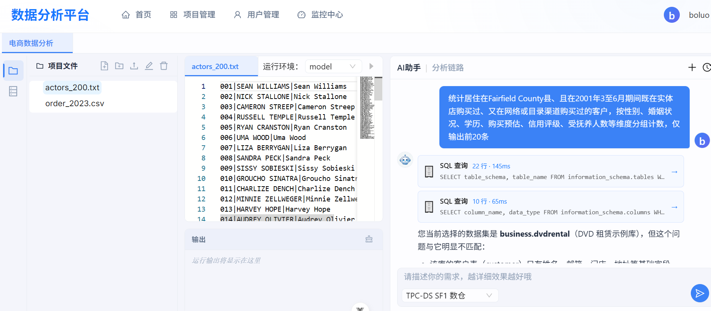
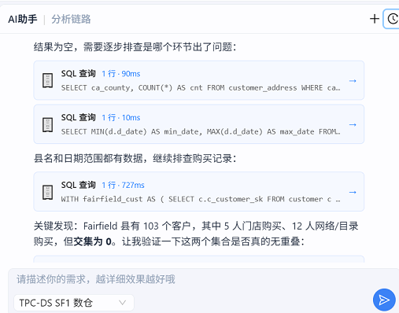
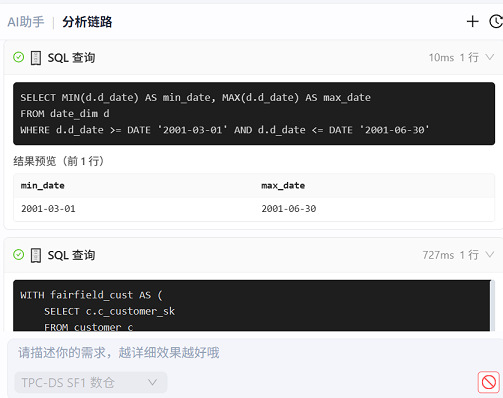

# AI 数据分析平台

AI 驱动数据应用快速交付平台，支持自然语言生成代码、数据分析、可视化报告，面向数据分析师。


## 技术架构

uv单体架构
```
┌──────────────────────────────────────────────────────┐
│                     Frontend (Vue 3)                  │
│         Ant Design Vue + Monaco Editor + ECharts      │
│                    Port: 5173 (dev)                   │
└──────────────────────┬───────────────────────────────┘
                       │ HTTP/SSE
┌──────────────────────▼───────────────────────────────┐
│                  API Gateway (FastAPI)               │
│         动态路由 · JWT 认证 · 限流 · IP 黑名单            │
│                    Port: 8456                        │
└─────────────────────────────────────────────────┘
                       │ 
┌──────────────────────▼──────────────────────────┐
│ User        App      AI             shared      │
│                                                 │
│ Infrastructure MySQL · Redis FastAPI  Prometheus│
└─────────────────────────────────────────────────┘
                                  
```

| 层级 | 技术选型 |
|---|---|
| 前端 | Vue 3 + TypeScript + Vite + Pinia + Ant Design Vue 4 |
| 编辑器 | Monaco Editor (`@guolao/vue-monaco-editor`) |
| 后端框架 | FastAPI (Python 3.12) |
| 数据库 | PostgreSQL 16 (SQLAlchemy + asyncpg 异步) + MySQL 8.0 |
| 缓存 | Redis 7 |
| 向量存储 | pgvector（PostgreSQL 扩展，记忆向量与行同表） |
| 监控 | Prometheus |
| 容器化 | Docker Compose |

## 基础设施

| 组件 | 用途 |
|---|---|
| **Redis** | 限流（固定窗口 INCR+EXPIRE）、记忆缓存 |
| **MySQL** | 平台业务表（用户 / 应用 / 项目成员） |
| **PostgreSQL** | 用户项目库、公共库、语义层、监控存储、记忆真源 + 向量（pgvector）、交互记录（月分区） |

## 模块说明（uv 单体架构，后续扩展可以拆分微服务）

```
backend/src/codegenx/
├── main.py               # 入口：组装全部 router 到同一个 app（统一 /api 前缀）
├── gateway/              # 请求入口层（路由在 main.py 最前面 include_router）
├── user_service/         # 用户模块（注册/登录/登出/用户信息）
├── app_service/          # 项目管理模块（代码文件、脚本运行、数据库）
├── ai_service/           # AI 核心（Agent Runtime / Hook / Memory / Tool / Trace）
├── shared/               # 共享（配置、异常、工具函数）
├── db/                   # 基础设施客户端（MySQL / PostgreSQL / Redis）
└── tests/                # 测试
```

| 模块 | 路由前缀 | 职责 |
|---|---|---|
| **gateway** | `/api/*` | JWT 认证、限流（固定窗口 5/s）、IP 黑名单、SSE 事件总线 |
| **user_service** | `/api/user/*` | 注册 / 登录 / 登出 / 用户信息（密码 MD5+盐加密） |
| **app_service** | `/api/app/*` | 项目 CRUD、代码文件树、在线编辑（Monaco Editor）、脚本运行、数据库创建删除 |
| **ai_service** | `/api/chat/*`、`/api/ai/*` | Agent 运行时、会话池、Hook 事件系统、记忆、全链路追踪 |
| **metrics** | `/metrics` | Prometheus 指标（无 `/api` 前缀，单独暴露） |

## 主要功能模块

### 项目管理
- 创建/删除/编辑应用项目
- 在线代码编辑器（语法高亮、文件树、多 Tab）
- Python 脚本在线运行，实时查看输出
- 代码文件上传、下载、重命名
- 项目数据库表结构浏览

### AI 对话式开发
- 自然语言描述需求，Agent 自动生成代码
- 多轮对话，支持流式输出
- 会话历史查看与继续
- 会话停止/中断控制
- 用户级频率限制

### 数据可视化 TODO
- ECharts 图表渲染
- 数据表浏览与查询
- 统计面板（Token 消耗、请求量、费用）

### 监控管理 (Admin)
- 会话监控面板（运行中/已完成/失败）
- 告警规则与告警记录
- Token 用量查询

### 用户与权限
- 用户注册 / 登录（JWT）
- 管理员角色（`admin`）
- 普通用户（`user`）项目隔离
- IP 黑名单管理

## Agent 技术架构总览

agent-as-tool 多智能体协作架构 + 分层韧性 + 事件驱动观测

```
┌──────────────────────────────────────────────────────────────┐
│                     Vue 3 前端                              │
│         Ant Design Vue · Monaco Editor · ECharts             │
└──────────────────────────┬───────────────────────────────────┘
                           │ HTTP / SSE
┌──────────────────────────▼───────────────────────────────────┐
│                FastAPI Gateway                                │
│     JWT 鉴权 · 固定窗口限流(5/s) · IP 黑名单 · SSE 事件总线     │
└──────────────────────────┬───────────────────────────────────┘
                           │
┌──────────────────────────▼───────────────────────────────────┐
│               AutoPlanManager（中央调度器）                   │
│  ┌─────────────────────────────────────────────────────────┐  │
│  │                SessionPool（内存会话池）                  │  │
│  │                  max 1000 · TTL 1h · LRU 回收           │  │
│  └─────────────────────────────────────────────────────────┘  │
│                           │                                   │
│  ┌────────────────────────▼───────────────────────────────┐  │
│  │               Leader Agent（ReAct 主循环）               │  │
│  │                 max_steps=50 · 单会话串行               │  │
│  │                                                         │  │
│  │  ┌───────────────────────────────────────────────────┐  │  │
│  │  │           agent-as-tool 子智能体（同步内联）        │  │  │
│  │  │  ┌───────────┐ ┌────────────┐ ┌───────────────┐  │  │  │
│  │  │  │  planner  │ │data_explore│ │ csv_explore   │  │  │  │
│  │  │  │(任务拆解  │ │(SQL/语义    │ │(文件探查     │  │  │  │
│  │  │  │  DAG看板) │ │  双数据源)  │ │  CSV/Python) │  │  │  │
│  │  │  └─────┬─────┘ └────┬───────┘ └──────┬────────┘  │  │  │
│  │  └────────┼────────────┼────────────────┼───────────┘  │  │
│  └───────────┼────────────┼────────────────┼───────────────┘  │
│              ▼            ▼                ▼                  │
│  ┌───────────────────────────────────────────────────────┐  │
│  │                  Tool Layer（26 个工具）               │  │
│  │                                                         │  │
│  │  ┌── 语义检索 ──┐  ┌── SQL 执行 ──┐  ┌── 看板管理 ──┐ │  │
│  │  │ search_tables │  │execute_pg    │  │ task_create  │ │  │
│  │  │ describe_card │  │(只读+超时熔断)│  │ task_update  │ │  │
│  │  │ find_join_path│  │              │  │ (claim/complet│ │  │
│  │  │ search_metrics│  │              │  │  e 解锁下游) │ │  │
│  │  └───────────────┘  └──────────────┘  └──────────────┘ │  │
│  │                                                         │  │
│  │  ┌── Python 沙箱 ──┐  ┌── 文件操作 ──┐  ┌── Agent 派发──┐│  │
│  │  │ run_python      │  │ read/write   │  │dispatch_agent││  │
│  │  │ code_check      │  │ edit/find/grep│ │ (同步内联)    ││  │
│  │  └─────────────────┘  └──────────────┘  └──────────────┘│  │
│  └───────────────────────────────────────────────────────┘  │
│                                                               │
│  ┌───────────────────────────────────────────────────────┐  │
│  │           Context Layer（会话上下文 + 子隔离）         │  │
│  │  session_context（主对话）· sub_context（子智能体隔离）  │  │
│  │  session_summary 自动提取（水位>10 条触发 LLM 摘要）    │  │
│  └───────────────────────────────────────────────────────┘  │
│                                                               │
│  ┌───────────────────────────────────────────────────────┐  │
│  │              Resilience Layer（韧性层）                 │  │
│  │  三态熔断器（闭合/打开/半开探测）                       │  │
│  │  按 (provider:model) 粒度独立熔断                       │  │
│  │  RETRYABLE / CONTEXT_OVERFLOW / FATAL / LOGIC 四分类    │  │
│  │  多模型 fallback 链（qwen3.8-max → deepseek → 自定义）  │  │
│  └───────────────────────────────────────────────────────┘  │
│                                                               │
│  ┌───────────────────────────────────────────────────────┐  │
│  │             Hook 事件系统（生命周期埋点）               │  │
│  │  before_tool_call · after_tool_call                     │  │
│  │  memory_turn_signal · tool_semantics_recorder           │  │
│  │  sql_trace_start/end 自动采集 SQL trace                 │  │
│  └───────────────────────────────────────────────────────┘  │
└──────────────────────────┬───────────────────────────────────┘
                           │
          ┌────────────────┼────────────────┐
          ▼                ▼                ▼
┌─────────────────┐ ┌─────────────────┐ ┌─────────────────┐
│  Hot Memory     │ │  Warm Memory    │ │  Semantic Layer  │
│  (PG 真源)      │ │  (pgvector 同表)│ │  (PostgreSQL +   │
│  衰减/归档/     │ │  向量/关键词     │ │   pgvector)      │
│  类型优先级裁剪 │ │  召回 + 合成     │ │  表卡/列/键/指标 │
│                 │ │                 │ │  向量化语义检索  │
└─────────────────┘ └─────────────────┘ └─────────────────┘
          │
          ▼
┌───────────────────────────────────────────────────────────────┐
│              Observation Layer（全链路观测）                   │
│  Trace Span 采集（request → agent → tool → sql → llm）        │
│  Prometheus 指标（LLM 调用/失败率/熔断状态/Token 消耗）        │
│  Telemetry 存储（PostgreSQL）                                 │
│  评测流水线（REPLAY → SCORE → REPORT）                        │
└───────────────────────────────────────────────────────────────┘
```

### 自研组件 vs 外部依赖

| 层级 | 自研 | 外部 |
|------|------|------|
| Agent Runtime | AutoPlanManager · ReAct Turn Loop · Context Builder · SubContext 隔离 | FastAPI · asyncpg |
| Agent 编排 | agent-as-tool 同步内联 · Planner DAG 看板 · TaskBoard claim/complete 闭环 | — |
| 工具系统 | 26 个工具 + Hook 参数守卫 + 工具白名单按 agent 粒度 | — |
| 韧性层 | 三态熔断器（状态机+asyncio.Lock 串行化）· 四分类错误处理 · 多模型 fallback 链 | OpenAI 兼容协议 |
| 观测 | Hook 事件系统 · Trace Span 采集 · SQL trace 自动标记 | Prometheus · Grafana |
| 记忆 | Hot/Warm 分层 · 衰减/归档 · Token 预算管控 · 会话摘要自动提取 | PostgreSQL · pgvector |
| 语义层 | 表卡/列/键/指标提取 + 向量化 · Hybrid 检索（向量+关键词）· pgvector | PostgreSQL · pgvector |
| 评测 | REPLAY/SCORE/REPORT 流水线 · Valid/EX/VES 指标 · 失败归因分类 | — |

### 核心组件

| 组件 | 说明 |
|---|---|
| **AutoPlanManager** | 中央调度器，管理消息总线、会话池、工具注册、Hook 事件分发、Trace 采集 |
| **SessionPool** | 内存会话池，max 1000 并发，LRU 淘汰，空闲自动卸载 chat_messages（保留元数据） |
| **Turn Loop** | ReAct 多轮循环 ≤50 步，每轮：组装上下文 → LLM 推理 → 工具调用 → Hook 埋点 → 下一轮或退出 |
| **Leader Agent** | 主智能体，决策直接答复 / 自己执行 / 派发 planner / 派发子智能体；agent-as-tool 模式内联调度 |
| **Planner Agent** | 任务拆解为 DAG（depends_on 依赖链），自动登记 TaskBoard；执行完 task_update 解锁下游 |
| **SubContext** | 子智能体独立上下文隔离，避免 leader 对话历史污染；执行完同步写回真相源 |
| **Context Builder** | 动态组装 system prompt + session_summary + history messages + sub_context + tool results；超长自动压缩 |
| **LLM Resilience** | CircuitBreaker 三态状态机按 (provider:model) 粒度独立熔断；RETRYABLE/OVRFLOW/FATAL/LOGIC 四分类 |
| **Tool System** | 26 工具：语义检索 / SQL沙箱 / Python沙箱 / 文件操作 / 看板管理 / Agent派发 / Skill加载 |
| **Hook System** | 生命周期 Hook：before_tool_call / after_tool_call / on_turn_end / on_session_end；SQL trace 自动采集 |
| **Memory System** | Hot(确定性全量注入) · Warm(pgvector 语义召回) · Session(当前会话)；单表真源，向量与行同事务，衰减/归档/Token 管控 |
| **Semantic Layer** | PostgreSQL 表卡(列/类型/注释/主键) + 业务指标向量化；search_tables / describe_table_card / find_join_path |
| **Trace System** | 全链路 Span 采集（request→agent→tool→sql→llm）；Prometheus 指标暴露（LLM 调用/熔断状态/Token 消耗） |
| **Eval Pipeline** | REPLAY/SCORE/REPORT 三步流水线；Valid/EX/VES 指标；失败归因（result_mismatch/SQL_error/timeout/context_overflow） |
| **Task Board** | 会话内 DAG 看板；planner 登记 → leader claim in_progress → 执行完 task_update completed → 解锁下游 depends_on |


### 环境要求

python虚拟环境所在位置: .venv\Scripts\pyhton.exe

- Python 3.12+
- Node.js 20+
- MySQL 8.0
- PostgreSQL 16（含 pgvector 0.8+、pg_trgm 扩展）
- Redis 7

> 启动 MySQL、PostgreSQL、Redis、Prometheus
复制backend/.env.example为backend/.env.env,backend/config.json.example为config.json
修改配置文件中的参数为实际参数 ：
 系统参数：backend/.env 
 智能体参数：backend/config.json
     选择默认使用的模型，并设置agents列表中的参数defaults=True,填写你需要的provider ，并在下面的providers列表中补充url及密钥


### 手动
#### 1. 后端启动

```bash
# 安装依赖
cd backend
uv sync --default-index https://mirrors.aliyun.com/pypi/simple/

# 配置环境变量 (.env config.json)

# 启动
python backend/src/codegenx/__main__.py

```

#### 2. 前端启动

```bash
cd frontend
pnpm install
pnpm dev
```

#### 3. 停止服务

Ctrl+C 或关闭终端即可。

### Docker 部署

一条命令拉起数据服务 + 前后端 + 监控（全容器模式）：

```bash
# 1) 准备配置（必填：数据库密码、JWT、LLM provider API Key）
cp backend/.env.example backend/.env
cp .env.example .env

# 2) 一键构建并启动
docker compose --profile localdb --profile monitoring up -d --build

# 3) 首次启动（数据卷为空）自动按序执行 init/：
#      MySQL     : schema.sql（建库 dataagent：用户/应用/成员）→ seed.sql（admin / boluo123）
#      PostgreSQL: semantic_schema.sql（语义层 + pgvector）→ telemetry_schema.sql
#                  → pg_memory_schema.sql（记忆 + 交互记录月分区）
docker compose logs mysql | Select-String "initdb"

# 4) 验证
docker compose ps
docker compose exec -T mysql mysql -uroot -p"<root密码>" --default-character-set=utf8mb4 \
  -e "select userAccount,userName from dataagent.user;"
```

> 后端默认通过 `host.docker.internal` 访问宿主机数据服务。全容器模式需先把 compose 中
> backend 的 `MYSQL_HOST / POSTGRES_HOST / REDIS_HOST` 改为服务名
> （`mysql / postgres / redis`），并恢复对这三个服务的 `depends_on` 健康检查。

> **初始化说明**
> - 自动初始化仅在数据卷为空时触发；已有数据卷请手动补跑 init 脚本。
> - `seed.sql` 内置管理员 `admin / boluo123`，**上线前务必修改密码**。
> - 数据库默认端口与本地服务冲突时，可在根 `.env` 调整 `MYSQL_HOST_PORT` /
>   `POSTGRES_HOST_PORT` / `REDIS_HOST_PORT`。

> 当前开发环境的混合部署方式（数据服务用宿主机、前后端与监控用 Docker）及常用运维命令，
> 见 [deploy.md](./deploy.md)。

#### 容器说明

| 服务 | 镜像 | 宿主机端口 | profile | 说明 |
|---|---|---|---|---|
| **frontend** | `dataagent-frontend`（nginx:alpine） | 80（`FRONTEND_PORT`） | 默认 | 托管 Vite 构建产物，反代 `/api` → backend |
| **backend** | `dataagent-backend`（python:3.12-slim） | 8456（`APP_PORT`） | 默认 | FastAPI + uvicorn，暴露 API / `/docs` / `/metrics` |
| **prometheus** | `prom/prometheus` | 9090 | monitoring | 抓取后端 `/metrics` |
| **grafana** | `grafana/grafana` | 3000 | monitoring | 看板 `dataagent-overview` |
| **alertmanager** | `prom/alertmanager` | 9093 | monitoring | 告警路由 |
| **alert-sink** | 自研 | 9000 | monitoring | 接收 webhook 告警 |
| **mysql** | `mysql:8.0` | 3307 → 3306 | localdb | 平台业务表：用户 / 应用 / 成员（utf8mb4） |
| **postgres** | `pgvector/pgvector:pg16` | 5433 → 5432 | localdb | 主业务库 + 语义层 + 记忆真源 + 交互记录（含 pgvector） |
| **redis** | `redis:7-alpine` | 6380 → 6379 | localdb | 缓存 + 限流 |

> `localdb` 组的宿主机端口刻意避开 3306 / 5432 / 6379，防止与本地已安装的数据库冲突。
> 端口均可通过根 `.env` 覆盖。

#### 数据持久化

compose 定义 6 个 named volume（数据服务运行在容器内时生效），容器重建不会丢数据：

| Volume | 挂载路径 | 内容 |
|---|---|---|
| `dataagent_mysql_data` | `/var/lib/mysql` | MySQL 数据（平台业务表） |
| `dataagent_pg_data` | `/var/lib/postgresql/data` | PostgreSQL 主库（语义层 + 记忆 + 交互记录） |
| `dataagent_redis_data` | `/data` | Redis AOF 持久化 |
| `dataagent_data` | 后端容器 `/data` | 看板 JSON / 会话快照 / 归档 zip |
| `dataagent_prometheus_data` | `/prometheus` | Prometheus TSDB（15d 保留） |
| `dataagent_grafana_data` | `/var/lib/grafana` | Grafana 看板/用户配置 |


#### 目录结构

```
DataAgent/
├── docker-compose.yml            # 一键编排（profiles: 默认 / localdb / monitoring）
├── .env                          # compose 根变量（凭据、端口）
├── .env.example                  # 根变量模板
├── deploy.md                     # 当前混合部署方式与常用运维
├── init/                         # 数据库初始化脚本
│   ├── schema.sql                # MySQL：建库 dataagent + 业务表（用户/应用/成员）
│   ├── seed.sql                  # MySQL：初始化 admin 用户
│   ├── semantic_schema.sql       # PostgreSQL：语义层 + pgvector
│   ├── telemetry_schema.sql      # PostgreSQL：监控 telemetry
│   └── pg_memory_schema.sql      # PostgreSQL：记忆（pgvector）+ 交互记录月分区
│
├── backend/
│   ├── Dockerfile                # 多阶段构建（builder 安装依赖 → slim 运行）
│   ├── .dockerignore
│   ├── .env.example              # 后端运行时配置模板
│   └── src/ ...
│
├── frontend/
│   ├── Dockerfile                # 多阶段构建（node 构建 → nginx:alpine 运行）
│   ├── .dockerignore
│   ├── docker/
│   │   └── nginx.conf            # SPA 路由 + /api 反代 + SSE 长连接
│   └── src/ ...
│
└── infra/monitoring/             # Prometheus / Grafana / Alertmanager 配置
    ├── prometheus.yml
    ├── prometheus_alerts.yml
    └── grafana/dashboards/dataagent-overview.json
```

#### 生产部署检查清单

- [ ] 后端 `backend/.env` 中 `JWT_ALGORITHM=RS256`，配好私钥路径（不要用 HS256 对称密钥）
- [ ] `MYSQL_ROOT_PASSWORD` / `POSTGRES_PASSWORD` / `REDIS_PASSWORD` / `JWT_SECRET` / `GRAFANA_PASSWORD` 改掉默认值
- [ ] 后端 `config.json` 中的 LLM provider API Key 已填入
- [ ] 配置 HTTPS（Nginx 加 SSL 或前置 LB）
- [ ] 数据库初始化脚本已执行（容器模式首次启动自动执行；本地服务需手动跑 init/*.sql，见 [deploy.md](./deploy.md)）
- [ ] 管理员默认密码 `boluo123` 已修改（seed.sql 初始化）
- [ ] 数据库字符集为 utf8mb4（init 脚本已内置 `SET NAMES utf8mb4`，勿删除）
- [ ] 日志持久化（Docker 日志默认在 `/var/lib/docker/containers/`，建议配日志驱动）

## 其它详细设计说明

docs/ 下：

- [Runtime与系统架构设计.md](./docs/Runtime与系统架构设计.md) — 系统总览、JWT、限流、Runtime 请求全链路、SystemApp 组件容器
- [多Agent设计.md](./docs/多Agent设计.md) — 智能体架构、agent-as-tool 内联执行、看板显式管理
- [数据分析工具技能设计.md](./docs/数据分析工具技能设计.md) — 工具注册机制、工具清单、Manager 设计、大表处理策略
- [Hook设计.md](./docs/Hook设计.md) — 事件清单、分发模式、启动注册、HookContext
- [Session管理.md](./docs/Session管理.md) — 会话生命周期、SessionPool LRU + cleanup、停止机制
- SystemApp架构设计.md
- 上下文工程设计.md
- LLM调用设计方案.md
- 记忆系统设计.md
- 语义层设计.md
- 用户项目权限与存储隔离方案.md
- [问答评测设计.md](./docs/问答评测设计.md) 

scripts/:
    - collector: 语义层采集脚本
    - eval: sql问答评测问答对、评测脚本

tests/:
    - llm_breaker: 测试LLM熔断器
    - test_chat_stream.py: 交互式基本测试
    - test_concurrent.py: 测试并发请求

