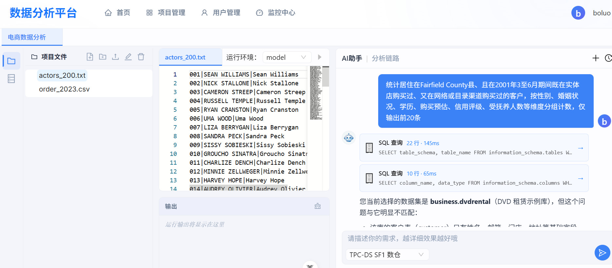
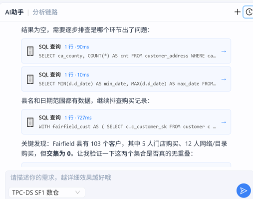
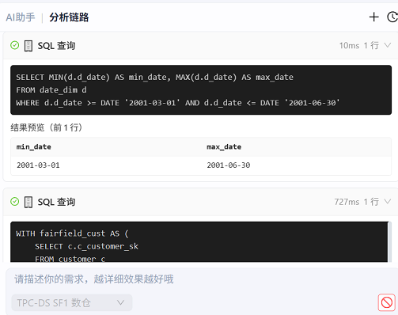

# AI 数据分析平台

AI 驱动数据应用快速交付平台，支持自然语言生成代码、数据分析、可视化报告，面向数据分析师。


## 技术架构

uv单体架构
```
┌──────────────────────────────────────────────────────┐
│                     Frontend (Vue 3)                  │
│         Ant Design Vue + Monaco Editor + ECharts      │
│                    Port: 5173 (dev)                   │
└──────────────────────┬───────────────────────────────┘
                       │ HTTP/SSE
┌──────────────────────▼───────────────────────────────┐
│                  API Gateway (FastAPI)               │
│         动态路由 · JWT 认证 · 限流 · IP 黑名单            │
│                    Port: 8456                        │
└─────────────────────────────────────────────────┘
                       │ 
┌──────────────────────▼──────────────────────────┐
│ User        App      AI             shared      │
│                                                 │
│ Infrastructure MySQL · Redis FastAPI  Prometheus│
└─────────────────────────────────────────────────┘
                                  
```

| 层级 | 技术选型 |
|---|---|
| 前端 | Vue 3 + TypeScript + Vite + Pinia + Ant Design Vue 4 |
| 编辑器 | Monaco Editor (`@guolao/vue-monaco-editor`) |
| 后端框架 | FastAPI (Python 3.12) |
| 数据库 | PostgreSQL 8.0 (SQLAlchemy + asyncpg 异步) |
| 缓存 | Redis 7 |
| 向量存储 | Qdrant |
| 监控 | Prometheus |
| 容器化 | Docker Compose |

## 基础设施

| 组件 | 用途 |
|---|---|
| **Redis** | 限流（固定窗口 INCR+EXPIRE）、记忆缓存 |
| **MySQL** | 用户类数据、记忆真源 |
| **PostgreSQL** | 用户项目库、公共库、语义层、监控存储（主业务数据库） |
| **Qdrant** | Warm 层记忆向量检索、语义表卡向量检索 |

## 模块说明（uv 单体架构，后续扩展可以拆分微服务）

```
backend/src/codegenx/
├── main.py               # 入口：组装全部 router 到同一个 app（统一 /api 前缀）
├── gateway/              # 请求入口层（路由在 main.py 最前面 include_router）
├── user_service/         # 用户模块（注册/登录/登出/用户信息）
├── app_service/          # 项目管理模块（代码文件、脚本运行、数据库）
├── ai_service/           # AI 核心（Agent Runtime / Hook / Memory / Tool / Trace）
├── shared/               # 共享（配置、异常、工具函数）
├── db/                   # 基础设施客户端（MySQL / PostgreSQL / Redis / Qdrant）
└── tests/                # 测试
```

| 模块 | 路由前缀 | 职责 |
|---|---|---|
| **gateway** | `/api/*` | JWT 认证、限流（固定窗口 5/s）、IP 黑名单、SSE 事件总线 |
| **user_service** | `/api/user/*` | 注册 / 登录 / 登出 / 用户信息（密码 MD5+盐加密） |
| **app_service** | `/api/app/*` | 项目 CRUD、代码文件树、在线编辑（Monaco Editor）、脚本运行、数据库创建删除 |
| **ai_service** | `/api/chat/*`、`/api/ai/*` | Agent 运行时、会话池、Hook 事件系统、记忆、全链路追踪 |
| **metrics** | `/metrics` | Prometheus 指标（无 `/api` 前缀，单独暴露） |

## 主要功能模块

### 项目管理
- 创建/删除/编辑应用项目
- 在线代码编辑器（语法高亮、文件树、多 Tab）
- Python 脚本在线运行，实时查看输出
- 代码文件上传、下载、重命名
- 项目数据库表结构浏览

### AI 对话式开发
- 自然语言描述需求，Agent 自动生成代码
- 多轮对话，支持流式输出
- 会话历史查看与继续
- 会话停止/中断控制
- 用户级频率限制

### 数据可视化 TODO
- ECharts 图表渲染
- 数据表浏览与查询
- 统计面板（Token 消耗、请求量、费用）

### 监控管理 (Admin)
- 会话监控面板（运行中/已完成/失败）
- 告警规则与告警记录
- Token 用量查询

### 用户与权限
- 用户注册 / 登录（JWT）
- 管理员角色（`admin`）
- 普通用户（`user`）项目隔离
- IP 黑名单管理

## Agent 技术架构总览

agent-as-tool 多智能体协作架构 + 分层韧性 + 事件驱动观测

```
┌──────────────────────────────────────────────────────────────┐
│                     Vue 3 前端                              │
│         Ant Design Vue · Monaco Editor · ECharts             │
└──────────────────────────┬───────────────────────────────────┘
                           │ HTTP / SSE
┌──────────────────────────▼───────────────────────────────────┐
│                FastAPI Gateway                                │
│     JWT 鉴权 · 固定窗口限流(5/s) · IP 黑名单 · SSE 事件总线     │
└──────────────────────────┬───────────────────────────────────┘
                           │
┌──────────────────────────▼───────────────────────────────────┐
│               AutoPlanManager（中央调度器）                   │
│  ┌─────────────────────────────────────────────────────────┐  │
│  │                SessionPool（内存会话池）                  │  │
│  │                  max 1000 · TTL 1h · LRU 回收           │  │
│  └─────────────────────────────────────────────────────────┘  │
│                           │                                   │
│  ┌────────────────────────▼───────────────────────────────┐  │
│  │               Leader Agent（ReAct 主循环）               │  │
│  │                 max_steps=50 · 单会话串行               │  │
│  │                                                         │  │
│  │  ┌───────────────────────────────────────────────────┐  │  │
│  │  │           agent-as-tool 子智能体（同步内联）        │  │  │
│  │  │  ┌───────────┐ ┌────────────┐ ┌───────────────┐  │  │  │
│  │  │  │  planner  │ │data_explore│ │ csv_explore   │  │  │  │
│  │  │  │(任务拆解  │ │(SQL/语义    │ │(文件探查     │  │  │  │
│  │  │  │  DAG看板) │ │  双数据源)  │ │  CSV/Python) │  │  │  │
│  │  │  └─────┬─────┘ └────┬───────┘ └──────┬────────┘  │  │  │
│  │  └────────┼────────────┼────────────────┼───────────┘  │  │
│  └───────────┼────────────┼────────────────┼───────────────┘  │
│              ▼            ▼                ▼                  │
│  ┌───────────────────────────────────────────────────────┐  │
│  │                  Tool Layer（26 个工具）               │  │
│  │                                                         │  │
│  │  ┌── 语义检索 ──┐  ┌── SQL 执行 ──┐  ┌── 看板管理 ──┐ │  │
│  │  │ search_tables │  │execute_pg    │  │ task_create  │ │  │
│  │  │ describe_card │  │(只读+超时熔断)│  │ task_update  │ │  │
│  │  │ find_join_path│  │              │  │ (claim/complet│ │  │
│  │  │ search_metrics│  │              │  │  e 解锁下游) │ │  │
│  │  └───────────────┘  └──────────────┘  └──────────────┘ │  │
│  │                                                         │  │
│  │  ┌── Python 沙箱 ──┐  ┌── 文件操作 ──┐  ┌── Agent 派发──┐│  │
│  │  │ run_python      │  │ read/write   │  │dispatch_agent││  │
│  │  │ code_check      │  │ edit/find/grep│ │ (同步内联)    ││  │
│  │  └─────────────────┘  └──────────────┘  └──────────────┘│  │
│  └───────────────────────────────────────────────────────┘  │
│                                                               │
│  ┌───────────────────────────────────────────────────────┐  │
│  │           Context Layer（会话上下文 + 子隔离）         │  │
│  │  session_context（主对话）· sub_context（子智能体隔离）  │  │
│  │  session_summary 自动提取（水位>10 条触发 LLM 摘要）    │  │
│  └───────────────────────────────────────────────────────┘  │
│                                                               │
│  ┌───────────────────────────────────────────────────────┐  │
│  │              Resilience Layer（韧性层）                 │  │
│  │  三态熔断器（闭合/打开/半开探测）                       │  │
│  │  按 (provider:model) 粒度独立熔断                       │  │
│  │  RETRYABLE / CONTEXT_OVERFLOW / FATAL / LOGIC 四分类    │  │
│  │  多模型 fallback 链（qwen3.8-max → deepseek → 自定义）  │  │
│  └───────────────────────────────────────────────────────┘  │
│                                                               │
│  ┌───────────────────────────────────────────────────────┐  │
│  │             Hook 事件系统（生命周期埋点）               │  │
│  │  before_tool_call · after_tool_call                     │  │
│  │  memory_turn_signal · tool_semantics_recorder           │  │
│  │  sql_trace_start/end 自动采集 SQL trace                 │  │
│  └───────────────────────────────────────────────────────┘  │
└──────────────────────────┬───────────────────────────────────┘
                           │
          ┌────────────────┼────────────────┐
          ▼                ▼                ▼
┌─────────────────┐ ┌─────────────────┐ ┌─────────────────┐
│  Hot Memory     │ │  Warm Memory    │ │  Semantic Layer  │
│  (MySQL 真源)   │ │  (Qdrant 向量)  │ │  (PostgreSQL +   │
│  衰减/归档/     │ │  关键词/主题     │ │   pgvector)      │
│  定时一致性校验 │ │  召回 + 合成     │ │  表卡/列/键/指标 │
│                 │ │                 │ │  向量化语义检索  │
└─────────────────┘ └─────────────────┘ └─────────────────┘
          │
          ▼
┌───────────────────────────────────────────────────────────────┐
│              Observation Layer（全链路观测）                   │
│  Trace Span 采集（request → agent → tool → sql → llm）        │
│  Prometheus 指标（LLM 调用/失败率/熔断状态/Token 消耗）        │
│  Telemetry 存储（PostgreSQL）                                 │
│  评测流水线（REPLAY → SCORE → REPORT）                        │
└───────────────────────────────────────────────────────────────┘
```

### 自研组件 vs 外部依赖

| 层级 | 自研 | 外部 |
|------|------|------|
| Agent Runtime | AutoPlanManager · ReAct Turn Loop · Context Builder · SubContext 隔离 | FastAPI · asyncpg |
| Agent 编排 | agent-as-tool 同步内联 · Planner DAG 看板 · TaskBoard claim/complete 闭环 | — |
| 工具系统 | 26 个工具 + Hook 参数守卫 + 工具白名单按 agent 粒度 | — |
| 韧性层 | 三态熔断器（状态机+asyncio.Lock 串行化）· 四分类错误处理 · 多模型 fallback 链 | OpenAI 兼容协议 |
| 观测 | Hook 事件系统 · Trace Span 采集 · SQL trace 自动标记 | Prometheus · Grafana |
| 记忆 | Hot/Warm 分层 · 衰减/归档/定时校验 · Token 预算管控 · 会话摘要自动提取 | MySQL · Qdrant |
| 语义层 | 表卡/列/键/指标提取 + 向量化 · Hybrid 检索（向量+关键词）· pgvector | PostgreSQL · pgvector |
| 评测 | REPLAY/SCORE/REPORT 流水线 · Valid/EX/VES 指标 · 失败归因分类 | — |

### 核心组件

| 组件 | 说明 |
|---|---|
| **AutoPlanManager** | 中央调度器，管理消息总线、会话池、工具注册、Hook 事件分发、Trace 采集 |
| **SessionPool** | 内存会话池，max 1000 并发，LRU 淘汰，空闲自动卸载 chat_messages（保留元数据） |
| **Turn Loop** | ReAct 多轮循环 ≤50 步，每轮：组装上下文 → LLM 推理 → 工具调用 → Hook 埋点 → 下一轮或退出 |
| **Leader Agent** | 主智能体，决策直接答复 / 自己执行 / 派发 planner / 派发子智能体；agent-as-tool 模式内联调度 |
| **Planner Agent** | 任务拆解为 DAG（depends_on 依赖链），自动登记 TaskBoard；执行完 task_update 解锁下游 |
| **SubContext** | 子智能体独立上下文隔离，避免 leader 对话历史污染；执行完同步写回真相源 |
| **Context Builder** | 动态组装 system prompt + session_summary + history messages + sub_context + tool results；超长自动压缩 |
| **LLM Resilience** | CircuitBreaker 三态状态机按 (provider:model) 粒度独立熔断；RETRYABLE/OVRFLOW/FATAL/LOGIC 四分类 |
| **Tool System** | 26 工具：语义检索 / SQL沙箱 / Python沙箱 / 文件操作 / 看板管理 / Agent派发 / Skill加载 |
| **Hook System** | 生命周期 Hook：before_tool_call / after_tool_call / on_turn_end / on_session_end；SQL trace 自动采集 |
| **Memory System** | Hot(MySQL 真源) · Warm(Qdrant 向量召回) · Session(当前会话)；衰减/归档/定时校验/Token 管控 |
| **Semantic Layer** | PostgreSQL 表卡(列/类型/注释/主键) + 业务指标向量化；search_tables / describe_table_card / find_join_path |
| **Trace System** | 全链路 Span 采集（request→agent→tool→sql→llm）；Prometheus 指标暴露（LLM 调用/熔断状态/Token 消耗） |
| **Eval Pipeline** | REPLAY/SCORE/REPORT 三步流水线；Valid/EX/VES 指标；失败归因（result_mismatch/SQL_error/timeout/context_overflow） |
| **Task Board** | 会话内 DAG 看板；planner 登记 → leader claim in_progress → 执行完 task_update completed → 解锁下游 depends_on |


### 环境要求

python虚拟环境所在位置: .venv\Scripts\pyhton.exe

- Python 3.12+
- Node.js 20+
- MySQL 8.0
- PostgreSQL 16
- Redis 7
- Qdrant

> 启动 Mysql、PostgreSQL、Redis、Qdrant、Prometheus
复制backend/.env.example为backend/.env.env,backend/config.json.example为config.json
修改配置文件中的参数为实际参数 ：
 系统参数：backend/.env 
 智能体参数：backend/config.json
     选择默认使用的模型，并设置agents列表中的参数defaults=True,填写你需要的provider ，并在下面的providers列表中补充url及密钥


### 手动
#### 1. 后端启动

```bash
# 安装依赖
cd backend
uv sync --default-index https://mirrors.aliyun.com/pypi/simple/

# 配置环境变量 (.env config.json)

# 启动
python backend/src/codegenx/__main__.py

```

#### 2. 前端启动

```bash
cd frontend
pnpm install
pnpm dev
```

#### 3. 停止服务

Ctrl+C 或关闭终端即可。

### Docker 部署（推荐用于生产）

一键拉起全部服务（前端 + 后端 + MySQL + PostgreSQL + Redis + Qdrant）：

```bash
# 1) 准备后端配置（必填项：数据库密码、JWT、LLM provider API Key）
cp backend/.env.example backend/.env
# 编辑 backend/.env 填入真实密码和 Key

# 2) 准备 compose 根目录变量
cp .env.example .env
# 编辑 .env 填入 MYSQL_ROOT_PASSWORD / MYSQL_DB / MYSQL_USER / MYSQL_PASSWORD
#            POSTGRES_PASSWORD / REDIS_PASSWORD

# 3) 构建并启动（首次 build 较慢，后续 compose 会复用镜像层）
docker compose up -d --build

# 4) 等待数据库健康后，查看初始化结果
#    首次启动（数据卷为空）会自动按顺序执行 init/ 下脚本：
#      MySQL    : 01_schema.sql（建库 dataagent + 用户/项目等表）
#                 → 02_memory_schema.sql（记忆系统表）
#                 → 03_seed.sql（初始化 admin 用户，密码 boluo123）
#      PostgreSQL: 01_semantic_schema.sql（语义层 + pgvector）
#                 → 02_telemetry_schema.sql（监控 telemetry）
docker compose logs mysql | Select-String "initdb"     # PowerShell 查看初始化日志
docker compose exec -T mysql mysql -uroot -p"<root密码>" -e "select userAccount,userRole from dataagent.user;"

# 5) 已有数据卷 / 手动补跑初始化脚本（自动化入口只在空库时执行一次）
docker compose exec -T mysql mysql -uroot -p"<root密码>" < init/schema.sql
docker compose exec -T mysql mysql -uroot -p"<root密码>" < init/memory_schema.sql
docker compose exec -T mysql mysql -uroot -p"<root密码>" < init/seed.sql
docker compose exec -T postgres psql -U postgres -f - < init/semantic_schema.sql
docker compose exec -T postgres psql -U postgres -f - < init/telemetry_schema.sql

# 6) 查看运行状态
docker compose ps
docker compose logs -f backend        # 看后端日志
docker compose logs -f frontend       # 看前端 Nginx 日志

# 7) 访问
#    前端：http://localhost
#    API 健康检查：http://localhost/api/health
#    Prometheus 指标：http://localhost/metrics

# 8) 停止并清理（注意 -v 会清空数据卷，谨慎使用）
docker compose down
docker compose down -v                # 彻底清除数据（仅调试阶段用）

# 9) 重新构建某个服务（代码更新后）
docker compose up -d --build backend
docker compose up -d --build frontend
```

> **初始化说明**
> - 自动初始化仅在数据卷为空时触发；若服务已启动过，请按第 5 步手动补跑。
> - `seed.sql` 内置管理员 `admin / boluo123`，**上线前务必修改密码**。

#### 容器说明

| 服务 | 镜像 | 端口 | 说明 |
|---|---|---|---|
| **frontend** | `codegenx-frontend` (nginx:alpine) | 80（可改 FRONTEND_PORT） | 托管 Vite 构建产物，反向代理 `/api` → backend |
| **backend** | `codegenx-backend` (python:3.12-slim) | 内部 8456 | FastAPI + uvicorn，只在 compose 网络内暴露 |
| **mysql** | `mysql:8.0` | 内部 3306 | 用户类数据 + 记忆真源（utf8mb4） |
| **postgres** | `pgvector/pgvector:pg16` | 内部 5432 | 主业务库 + 语义层 + pgvector 扩展 |
| **redis** | `redis:7-alpine` | 内部 6379 | 缓存 + 限流 |
| **qdrant** | `qdrant/qdrant` | 内部 6333 | 向量存储（记忆 + 语义检索） |

#### 数据持久化

compose 定义了 5 个 named volume，容器重建不会丢数据：

| Volume | 挂载路径 | 内容 |
|---|---|---|
| `mysql_data` | `/var/lib/mysql` | MySQL 数据（用户类数据、记忆真源） |
| `pg_data` | `/var/lib/postgresql/data` | PostgreSQL 主库 |
| `redis_data` | `/data` | Redis AOF 持久化 |
| `qdrant_data` | `/qdrant/storage` | Qdrant 向量数据 |
| `codegenx_data` | 后端容器 `/data` | 看板 JSON / 会话快照 / chat_message |

> ⚠️ `docker compose down -v` 会删除全部 volume。如果只是重启服务，用 `docker compose down`（不加 -v）。

#### 目录结构

```
DataAgent/
├── docker-compose.yml            # 一键编排（根目录）
├── .env.example                  # compose 根变量（MYSQL_* / POSTGRES_* 等）
├── .dockerignore                 # 根目录构建忽略
├── init/                         # 数据库初始化脚本（首次启动自动执行）
│   ├── schema.sql                # MySQL：建库 dataagent + 业务表
│   ├── memory_schema.sql         # MySQL：记忆系统表
│   ├── seed.sql                  # MySQL：初始化 admin 用户
│   ├── semantic_schema.sql       # PostgreSQL：语义层 + pgvector
│   └── telemetry_schema.sql      # PostgreSQL：监控 telemetry
│
├── backend/
│   ├── Dockerfile                # 后端多阶段构建（python:3.12-slim 运行）
│   ├── .dockerignore
│   ├── .env.example              # 后端运行时配置模板
│   └── src/ ...
│
└── frontend/
    ├── Dockerfile                # 前端多阶段构建（nginx:alpine 运行）
    ├── .dockerignore
    ├── docker/
    │   └── nginx.conf            # SPA 路由 + /api 反向代理 + SSE 长连接
    └── src/ ...
```

#### 生产部署检查清单

- [ ] 后端 `backend/.env` 中 `JWT_ALGORITHM=RS256`，配好私钥路径（不要用 HS256 对称密钥）
- [ ] `MYSQL_ROOT_PASSWORD` / `MYSQL_PASSWORD` / `POSTGRES_PASSWORD` / `REDIS_PASSWORD` / `JWT_SECRET` 改掉默认值
- [ ] 后端 `config.json` 中的 LLM provider API Key 已填入
- [ ] 配置 HTTPS（Nginx 加 SSL 或前置 LB）
- [ ] 数据库初始化脚本已随 compose 首次启动自动执行（MySQL: schema → memory_schema → seed；PG: semantic → telemetry）
- [ ] 管理员默认密码 `boluo123` 已修改（seed.sql 初始化）
- [ ] 日志持久化（Docker 日志默认在 `/var/lib/docker/containers/`，建议配日志驱动）

## 其它详细设计说明

docs/ 下：

- [Runtime与系统架构设计.md](./docs/Runtime与系统架构设计.md) — 系统总览、JWT、限流、Runtime 请求全链路、SystemApp 组件容器
- [多Agent设计.md](./docs/多Agent设计.md) — 智能体架构、agent-as-tool 内联执行、看板显式管理
- [数据分析工具技能设计.md](./docs/数据分析工具技能设计.md) — 工具注册机制、工具清单、Manager 设计、大表处理策略
- [Hook设计.md](./docs/Hook设计.md) — 事件清单、分发模式、启动注册、HookContext
- [Session管理.md](./docs/Session管理.md) — 会话生命周期、SessionPool LRU + cleanup、停止机制
- SystemApp架构设计.md
- 上下文工程设计.md
- LLM调用设计方案.md
- 记忆系统设计.md
- 语义层设计.md
- 用户项目权限与存储隔离方案.md
- [问答评测设计.md](./docs/问答评测设计.md) 